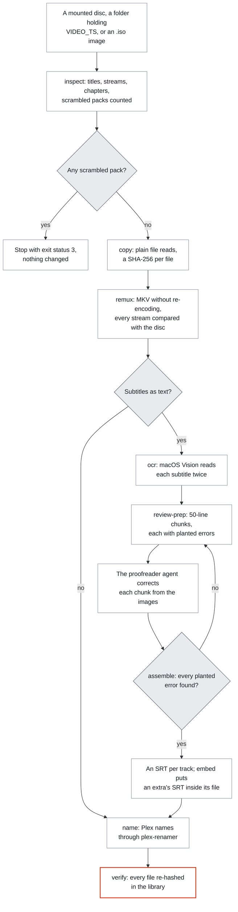
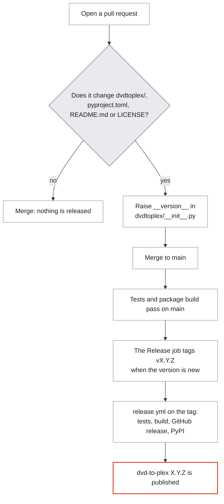

<div align="center">


# 📀 dvd-to-plex

### Your DVDs in Plex, bit for bit, with subtitles you can trust.

**A command-line tool and a Claude Code plugin that turn an unscrambled DVD-Video into MKV files
under the names Plex expects, without re-encoding a single frame.** Every stage checks its own
work: the streams in each MKV are checked packet by packet against the disc, and the disc subtitles
are read into text that an AI proofreader corrects against the subtitle images, with planted
errors that prove it really looked.

<br>

[](https://pypi.org/project/dvd-to-plex/)


<br>


<br>

**[What it does](#-what-it-does) · [What it checks](#-what-it-checks) · [What it won't do](#-what-it-wont-do) · [Install](#-install) · [First run](#-your-first-run) · [Claude Code](#-with-claude-code) · [Planted errors](#-how-the-planted-errors-work) · [Commands](#-commands) · [Limits](#-known-limitations) · [Docs](#-documentation) · [Contributing](#-contributing) · [Support](#-support-this-project)**

</div>

---

## 🧭 What it does

A DVD keeps its film in VOB files, split across titles, cells and chapters that a media server
can't read as one film. dvd-to-plex reads the disc's own tables, copies each title you keep into
an MKV file with the same video and audio packets, and gives the files the folder and file names
Plex documents. The disc subtitles come along twice: as the original pictures inside the MKV, and,
if you want them, as text in SRT files that you can search, restyle and read on any player.



Here is the sample disc (see [your first run](#-your-first-run)) after a full run through the
plugin, with the main title as the film and the two short ones as extras:

```
Movies/
  Example Film (2024) {imdb-tt0000001}/
    Example Film (2024) {imdb-tt0000001}.mkv
    Example Film (2024) {imdb-tt0000001}.de.srt
    Behind The Scenes/
      Making Of.mkv
    Trailers/
      Trailer.mkv
```

The film's German subtitles sit beside it as text. The making-of carries its German SRT inside the
file, because Plex doesn't pick up sidecar subtitles for local extras (going by reports on the Plex
forum). The names come from [plex-renamer](https://github.com/agusgonzaleznic/plex-renamer), so a
library renamed with it and one filled with dvd-to-plex follow the same rules.

---

## ✅ What it checks

Each stage refuses to hand on work it could not check. The tests feed the broken inputs in the
last column to the stage or to its check and must see it fail, so a check that let everything
through would turn CI red. Some checks have no such test yet; the [architecture page](https://github.com/agusgonzaleznic/dvd-to-plex/blob/main/docs/architecture.md#12-not-in-this-version) lists them.

| Stage | What it checks | Broken inputs in its tests |
|---|---|---|
| `inspect` | Counts scrambled packs (about 4096 per VOB file, or all with `--full-scan`); reads disc files only as regular files, never through a link; flags titles with several angles or interleaved cells | A cut IFO file, an oversized one, a title pointing past its table, a link, a scrambled pack |
| `copy` | Checks the same sample of packs for scrambling first, then every pack as it copies; reads with plain file reads only and doesn't follow a link; stops at the first read error, never skips or pads; a SHA-256 per file | A read error, a link, a scrambled pack, one between the samples |
| `remux` | The copy's SHA-256 again, when `copy` made it; every pack scanned for scrambling; video and audio packets hashed and compared with the disc; duration equal to the disc's tables; audio start offset kept; a full decode with no errors; each subtitle packet's bytes and time | A copy changed after `copy`, a stream one second short, corrupted video, a subtitle shifted in time |
| `ocr` | Each subtitle read twice, as is and at twice the size without language correction, so later stages know where the readings agree | A blank image, a subtitle whose control sequences overlap, and an accuracy floor on the sample |
| `assemble` | Each chunk's planted errors: a chunk passes only if every one was put right; no answer may add or split a cue | A planted error kept, a line cut, an answer with a blank line or a timing line |
| `embed` | Every original stream keeps its packets and properties; each new text track reads back as its SRT | A cut or retagged stream, text that doesn't read back |
| `name` | The names read back through plex-renamer; each file matches its remux or embed report before it moves | A file changed after remux, a name plex-renamer reads differently |
| `verify` | Every file in the library re-hashed against its report; plex-renamer wants to move nothing | One file altered, one missing |

An MKV only appears in `WORK/out` once all its checks pass. When one fails, its work folder keeps
everything, with a `report.json` that names the check, and `remux` exits 1 after the other titles.

---

## ⛔ What it won't do

**It reads only unscrambled DVD-Video.** Many commercial DVDs carry CSS scrambling. When
dvd-to-plex finds a scrambled pack, it prints this and changes nothing:

```
This disc's video is scrambled. dvd-to-plex reads only unscrambled DVD-Video, so it stops here and changes nothing.
```

That stop is by design and will stay. The tool reads the disc with plain file reads only, and the
Claude Code plugin stops there too and suggests nothing. Issues asking to change this are closed.

It also never re-encodes, never fetches subtitles or metadata from the web, and never deletes a
file you had: `embed` keeps the file it replaces in a `retired-` folder named by date.

---

## ⚡ Install

You need a Mac, Python 3.12 or newer, and:

| Tool | Why | How |
|---|---|---|
| ffmpeg and ffprobe | Remuxing and every packet check | `brew install ffmpeg` |
| Xcode command line tools | `swiftc` builds the small subtitle reader on first use, into `~/Library/Caches/dvd-to-plex`; the plugin's guard runs on their Python | `xcode-select --install` |

Then install the command:

```bash
uv tool install dvd-to-plex      # or: pipx install dvd-to-plex
```

Each [GitHub release](https://github.com/agusgonzaleznic/dvd-to-plex/releases) carries the wheel,
the source archive and a `SHA256SUMS` file. To check the files of the latest release before you
install them, in an empty folder:

```bash
gh release download -R agusgonzaleznic/dvd-to-plex --pattern '*'
shasum -a 256 -c SHA256SUMS
uv tool install ./dvd_to_plex-*.whl
```

Each line of the check must end in `OK`.

---

## 🚀 Your first run

Try it on the sample disc before a real one. `sample` writes a small DVD-Video folder with three
titles: a 12-second film in four chapters with German and commentary audio and German subtitles,
and two short extras. It authors the disc with `dvdauthor` and `spumux`, which must be on your
PATH; nothing else in the tool uses them.

```bash
cd ~
dvd-to-plex sample dvd-sample
dvd-to-plex inspect dvd-sample
```

```
VIDEO_TS: dvd-sample/VIDEO_TS
Standard: PAL
Scrambled packs: 0 of 1467 checked

Title  Set  Length   Ch  Audio                Subtitles  Notes
1      1    0:00:12  4   de, de (commentary)  de         main (longest)
2      2    0:00:05  1   en                   de
3      2    0:00:03  1   en                   -
```

Then copy and remux into a work folder. While a title is remuxed, the work folder needs free space
for about four times the disc.

```bash
dvd-to-plex copy dvd-sample dvd-work
dvd-to-plex remux dvd-work --titles 1,2,3 --prefer-audio de
```

```
title_01: ok -> dvd-work/out/title_01.mkv
title_02: ok -> dvd-work/out/title_02.mkv
title_03: ok -> dvd-work/out/title_03.mkv
```

For the subtitles as text, run `ocr` and `review-prep`, have each chunk proofread (the plugin does
this for you, see below), and run `assemble`. Then describe the titles in `dvd-work/names.json`
(`dvd-to-plex name --help` shows the format), and place and check them:

```bash
dvd-to-plex name dvd-work /Volumes/Media --dry-run
dvd-to-plex name dvd-work /Volumes/Media
dvd-to-plex verify dvd-work
```

The sample also writes `sample-truth.json` with every subtitle line as it was written, so you can
compare the SRTs with what the disc really says.

---

## 🤖 With Claude Code

The plugin drives the whole run for you: it inspects the disc, asks you which title is the film and
which are extras, runs each stage, and hands the subtitle chunks to its proofreader agent. Add it
in Claude Code:

```
/plugin marketplace add agusgonzaleznic/dvd-to-plex
/plugin install dvd-to-plex@dvd-to-plex
```

Then ask in plain words, for example *"Add the DVD in /Volumes/MY_FILM to my Plex library at
/Volumes/Media/Movies"*. The plugin brings:

- **The `dvd-to-plex` skill.** It runs the stages in order, stops on any failed check without
  working around it, and stops for good on a scrambled disc.
- **The `subtitle-proofreader` agent**, on Sonnet. It corrects one chunk from its contact sheets
  and writes that chunk's `answers.json`. A chunk that fails is redone with fresh planted
  errors on Opus.
- **A guard hook** that holds the proofreader to its own chunk's files (cues, contact sheets and
  answers), so it can't read the OCR output, the reports, another chunk or the key. When the guard
  can't run, the proofreader's calls are refused.

The checks live in the command, not in the plugin, so a stage the plugin runs can't skip one.

---

## 🧪 How the planted errors work

An AI proofreader can hand back the text it was given and call it done. To catch that,
`review-prep` plants a few errors in every chunk (three by default) in lines where both OCR
readings agree: a changed letter in a word, a dropped opening quote, or `l` for `L`, two misreads
Vision really makes. A planted line shows no second reading, so the only way to find the error is
to look at the subtitle image.

Which lines hold an error, and what it was, goes into a key folder outside the work folder
(`~/Library/Application Support/dvd-to-plex/keys`, or `DVDTOPLEX_KEYS`), stored as salted hashes.
`assemble` then scores every planted error. A chunk passes only if all of them were put right; one
missed error fails the whole chunk, and the message names counts, never the lines:

```
title_01.s0 chunk 1: 3 of 3 controls failed; redo it one model up (review-prep --redo title_01.s0/1)
```

`--redo` plants fresh errors in that chunk, so a second attempt can't learn the first one's key.

---

## 🧰 Commands

Every command takes `--help`. Exit status: **0** done, **1** an error or a failed check, **2** a
command line the argument parser rejects, **3** refused because the disc is scrambled.

| Command | What it does |
|---|---|
| `sample DEST` | Writes a small synthetic DVD-Video folder and its `sample-truth.json` |
| `inspect SOURCE` | Lists titles, streams and chapters; `--json` for the survey as JSON |
| `copy SOURCE WORK` | Copies `VIDEO_TS` into the work folder, stopping on any read error |
| `remux WORK` | One checked MKV per title in `WORK/out`; `--titles 1,3`, `--prefer-audio de` |
| `ocr WORK` | Reads each disc subtitle as text with macOS Vision; `--lang xx` overrides a wrong tag |
| `review-prep WORK` | Cuts the text into chunks with planted errors; `--redo TRACK/N` for one chunk |
| `assemble WORK` | Scores each chunk and writes an SRT per track whose chunks all passed |
| `embed WORK` | Adds the SRTs to their MKV as text tracks; `--files` to choose which |
| `name WORK LIBRARY` | Moves the files into the library under Plex names; `--dry-run` first |
| `verify WORK` | Re-hashes every placed file and reads the title folder back through plex-renamer |

`SOURCE` is a mounted disc, a folder that holds `VIDEO_TS`, or an `.iso` image. `WORK` is one
folder per disc.

---

## 🚧 Known limitations

- **Tested on the sample disc only, so far.** CI runs every stage and its failing inputs on the
  synthetic disc that `sample` writes, and the plugin was run end to end on it in a fresh Claude
  Code setup. Reports from real unscrambled discs are welcome.
- **macOS only.** The subtitle reader uses Apple's Vision framework and `swiftc`. CI runs on
  macOS 15 on Apple Silicon.
- **Films only.** `name` places a film with its extras; TV-series discs aren't supported yet.
- **Titles with several angles or interleaved cells** (seamless branching) are skipped, also
  when you ask for them by number.
- **A subtitle that can't be decoded is left out.** `ocr` says how many it skipped, and their
  lines are missing from the SRT.
- **Subtitles from the disc only.** It doesn't make subtitles from speech or translate them.
- **No Blu-ray.**
- **Open findings.** The [security audit](https://github.com/agusgonzaleznic/dvd-to-plex/blob/main/docs/security.md) and the
  [design review](https://github.com/agusgonzaleznic/dvd-to-plex/blob/main/docs/design-review.md) list what was found and not yet fixed.

---

## 📚 Documentation

| Page | What it holds |
|---|---|
| [Architecture](https://github.com/agusgonzaleznic/dvd-to-plex/blob/main/docs/architecture.md) | How the stages, the work folder and the plugin fit together, and why |
| [Development](https://github.com/agusgonzaleznic/dvd-to-plex/blob/main/docs/development.md) | Setting up a clone, the tests, CI, how a release happens, the checklist before a pull request |
| [Security posture](https://github.com/agusgonzaleznic/dvd-to-plex/blob/main/docs/security-posture.md) | What is in and out of scope for a report, and what the tool already does |
| [Security audit](https://github.com/agusgonzaleznic/dvd-to-plex/blob/main/docs/security.md) | The audit of 18 November 2026: threat model, findings and their status |
| [Design review](https://github.com/agusgonzaleznic/dvd-to-plex/blob/main/docs/design-review.md) | The two independent reviews, what each found, and what is still open |
| [Lessons learned](https://github.com/agusgonzaleznic/dvd-to-plex/blob/main/docs/lessons-learned.md) | What building it taught |
| [Asset provenance](https://github.com/agusgonzaleznic/dvd-to-plex/blob/main/docs/assets-provenance.md) | Where the emblem and everything on the sample disc come from |

---

## 🤝 Contributing

Issues and pull requests are welcome at
[github.com/agusgonzaleznic/dvd-to-plex](https://github.com/agusgonzaleznic/dvd-to-plex). Please
read the [contributing guide](https://github.com/agusgonzaleznic/.github/blob/main/CONTRIBUTING.md)
first, and [docs/development.md](https://github.com/agusgonzaleznic/dvd-to-plex/blob/main/docs/development.md) for what is specific to this repository.
When you report a bug, say whether it also happens on the sample disc.

Run the tests from a clone. They need ffmpeg, and `dvdauthor` and `spumux` on your PATH for the
sample disc:

```bash
python3 -m venv .venv
.venv/bin/pip install --require-hashes --no-deps -r requirements/runtime.txt
.venv/bin/python -m unittest discover -s tests -v
```

They build the sample disc and run every stage on it, and feed most checks a bad input they have
to reject. CI runs them on macOS, on Python 3.12 and 3.13, for every pull request and every push to
main. From a clone, `python3 -m dvdtoplex` runs the code in place.

### 🔁 How a release happens

The merge of a pull request is the release. Nobody pushes a tag by hand.



A pull request that changes what ships raises `__version__` in `dvdtoplex/__init__.py`, and its
check `Release / Check the version` fails until it does. Tests, docs and workflows ship with the
next version. The plugin is installed from main, so it changes with every merge. The release publishes the wheel, the source archive and their `SHA256SUMS`
on GitHub, then uploads the same files to PyPI with Trusted Publishing, so the workflow uses no
PyPI token.

---

## 💛 Support this project

dvd-to-plex is MIT-licensed and free to use. If it put your shelf of DVDs into Plex without losing
a frame, three things help:

- **Star the repo.** It tells the next person with a box of DVDs that this exists.
- **Open an issue** when a check fails on a disc that plays fine, with the stage, the message and
  the `report.json` it names.
- **Drop a coffee on Ko-fi, or sponsor on GitHub.** Ko-fi is a one-off, and GitHub Sponsors can
  be monthly or one-time, with a custom amount.

<div align="center">
<br>

[](https://ko-fi.com/agusgonzaleznic)
[](https://github.com/sponsors/agusgonzaleznic)
<br>
[](https://agusgonzaleznic.com)
[](https://github.com/agusgonzaleznic)
[](https://www.linkedin.com/in/agusgonzaleznic)

<br>

<sub>Built in Berlin by <b>Agustin Gonzalez Nicolini</b>. I work on engineering leadership and write
about it at <a href="https://agusgonzaleznic.com">agusgonzaleznic.com</a>.</sub>

</div>

---

## 📄 Licence

MIT. See [LICENSE](https://github.com/agusgonzaleznic/dvd-to-plex/blob/main/LICENSE).
