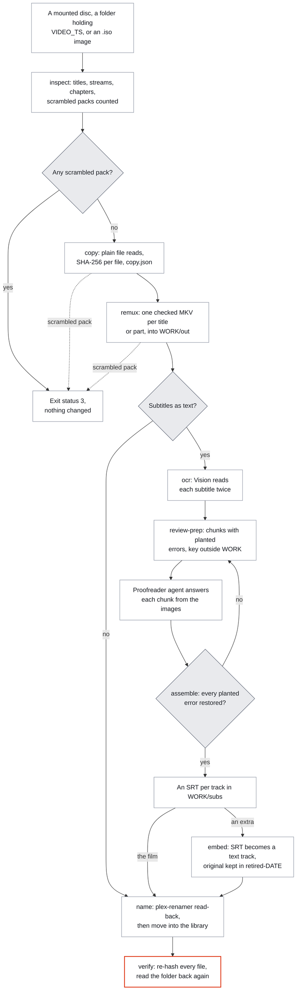

# Architecture

The design authority for dvd-to-plex: how the pieces fit, what each stage checks, what makes it
stop, and the reason for each choice where the code, a comment, a docstring or the README gives one.
The [README](../README.md) covers using the tool, [`development.md`](development.md) building,
testing and releasing it. Paths are relative to the repository root, or to the work folder (`WORK`).

## 1. Overview

dvd-to-plex is a Python command line tool (`dvd-to-plex`, package `dvdtoplex`) and a Claude Code
plugin. It reads an unscrambled DVD-Video, remuxes each title you keep into an MKV file without
re-encoding, reads the disc subtitles into text, and moves the files into a Plex library under the
names Plex documents. Every stage checks its own output; a failed check makes the command exit 1,
and no failed output replaces a good one.

- **The command.** One subcommand per stage; each stage is a module that reads what the one before
  left and writes its own result. Exit status: 0 done, 1 an error or a failed check, 2 a command
  line the argument parser rejects (a malformed `--titles` list gives 1), 3 refused because the disc
  is scrambled. `cli.py` maps stage errors to these.
- **The work folder.** One folder per disc, holding every result and a JSON record per stage. There
  is no database and no daemon: the files are the state.
- **The plugin.** A skill that drives the command in order, an agent that proofreads subtitle
  chunks, and a hook that holds that agent to its own chunk's files (its cues, sheets and
  answers). The plugin holds none of the stage checks, so a stage it runs cannot skip one; which
  stages run is up to the skill's instructions.

## 2. The stages



Three rules shape the stages, with the exceptions named. A stage re-checks what an earlier stage
recorded: `remux` re-hashes the copy when `copy.json` is there, `embed` and `name` hash the MKV
against its last report, `verify` hashes every placed file; `ocr`, `review-prep` and `assemble` read
their inputs as they are. A failed check leaves earlier results alone: an MKV appears in `WORK/out`
only when all its checks pass. And most checks have a test that feeds them a bad input and must see
them fail, so such a check that let everything through would turn CI red; section 12 lists the
checks that have none yet. Each stage names its controls. The stages `ocr`, `review-prep` and
`assemble` are in sections 6 and 7.

### 2.1 inspect

- **Modules:** `survey.py`, `ifo.py` (plain file reads of the IFO files, never a VOB, following the
  publicly documented layout), `scramble.py` (section 4), `source.py`.
- **Input:** a mounted disc, a folder holding `VIDEO_TS`, `VIDEO_TS` itself, or an `.iso` image. An
  ISO is attached read-only with `hdiutil` while in use, then detached.
- **Output:** a table, or with `--json` the survey: per title its set, length, chapters, audio and
  subtitle streams, palette and cells. The main title is the longest usable one.
- **Checks:** disc files are regular files, not links; the IFO signature, size (16 MiB at most) and
  length, and that titles point inside their tables; scrambled packs (about 4096 per VOB file spread
  evenly, fewer than 8192, or all with `--full-scan`). It marks a title with several angles, with
  interleaved cells, no cells or VOB files missing, and one whose cells repeat another's (duplicate).
- **Refuses:** a scrambled pack (exit 3); a path that is not a disc, or a bad IFO (exit 1). A title
  with a problem is listed with a note, not refused.
- **Controls:** `tests/test_inspect.py` scrambles a copy of the sample, cuts an IFO short, patches
  cell flags to make an angle block and an interleaved cell, copies one cell's sectors over
  another's to make a duplicate, and feeds a missing path, a text file and an empty folder.
  `tests/test_ifo.py` compares the IFO fields with the sample's truth.

### 2.2 copy

- **Module:** `dvdtoplex/copier.py`. **Input:** a disc as in `inspect`, and a work folder.
- **Output:** `WORK/VIDEO_TS` (IFO, BUP and VOB files) and `WORK/copy.json` with each file's name,
  size and SHA-256. Reads are unbuffered 1 MiB blocks, hashed as read, written to `<name>.part`,
  synced and renamed.
- **Refuses or fails:** a link or special file; a scrambled pack, found by a sampled scan before
  anything is copied (exit 3, no work folder) or in any pack while copying (exit 3, copy removed);
  an existing `WORK/VIDEO_TS`; less free space than the files plus 1 GiB; any read error, with file
  and byte offset; a short read. A failure removes its `.part` file and writes no `copy.json`.
  `copier.verify` re-hashes the copy for `remux`.
- **Controls:** `tests/test_copy.py` injects an I/O error on the second read (expects the stop, no
  partial file, no `copy.json`); scrambles a copy; alters a byte and removes a file; copies twice.
  `tests/test_disc_files.py` feeds links, a FIFO and packs scrambled off the sample.

### 2.3 remux

- **Modules:** `remux.py` (checks), `parts.py` (cells to files), `vob.py`, `media.py`. **Input:**
  `WORK/VIDEO_TS`. `--titles 1,3` picks titles; by default every title with no problem that is not a
  duplicate and lasts at least `--min-seconds` (5). `--prefer-audio de` sets the default audio
  language. A title with a problem is skipped even when named by number.
- **Output:** `WORK/out/title_NN.mkv` (`title_NN_partK.mkv` when split), a report per part in
  `WORK/remux/<stem>/report.json`, and `WORK/remux.json` with this run's reports. Before any title,
  a `copy.json` makes the command re-hash the copy, and every pack of the disc is scanned for
  scrambling; a change or a hit stops the command.
- **Planning (`parts.py`).** A cell under one second whose sectors two or more PGCs share is
  return-to-menu filler and is left out. Where a cell flagged as an STC discontinuity really
  restarts the video PTS (backwards, or forwards by more than a second), the title is split into
  parts, each its own file. Chapters come from the IFO.
- **Remuxing a part.** The part's sectors are cut into `cut.vob` and scanned again. Stage 1 copies
  the video and audio into Matroska. Each subtitle stream becomes a VobSub: its packs verbatim, the
  title's palette, each unit's time computed from its PTS anchored on the video's first PTS. The
  final file adds languages, titles, flags (default audio, `comment`, `forced`) and chapters, and
  carries no file tags over.

| Check | Compares |
|---|---|
| `scrambled` | Every pack of the cut |
| `anchor` | The first audio packet's time by formula against ffmpeg's, within 2 ms; counts only when the part has subtitles |
| `packets` | Size and SHA-256 of every video and audio packet in the MKV against the cut |
| `subtitles` | Each subtitle packet's bytes and time against the VobSub; ffmpeg's own timing of the stream on a short test mux, when the first subtitle is within 64 MiB of the cut's start |
| `duration` | The video's shown length against the IFO's, within two frames |
| `av_offset` | The audio start offset against the cut's, within 1 ms |
| `decode` | A full decode of every stream, with no error lines |

Only when all pass is the file moved to `WORK/out`, its size and SHA-256 recorded, and `cut.vob`,
`stage1.mkv` and the VobSub files removed. When one fails, the part's work folder keeps everything,
the command goes on with the next title, and at the end it exits 1, naming the failed checks. A
title whose output exists stops the command with exit 1; a part's work folder is deleted and rebuilt
at the start of each run. **Controls:** `tests/test_remux.py` shifts the subtitle index by 40 ms
(`times_ok` fails, `data_ok` holds); shifts the video anchor by 0.1 s (anchor and cross-check fail);
compares the packet hashes of a 5-second title with those of its first 4 seconds; flips 4096 bytes
of a file and expects decode errors; scrambles a cut; changes a copy after `copy`.

### 2.4 embed

- **Module:** `embed.py`. **Input:** the files in `out` with an SRT in `subs`, or `--files`.
- **Output:** the file in `out` now carries each SRT as a SubRip track tagged with its language,
  after every stream it had, with every stream's flags given explicitly;
  `WORK/embed/<stem>/report.json`; the original in `WORK/retired-YYYY-MM-DD/`, never deleted. The
  new file is built in `WORK/embed/<stem>/`.
- **Checks before it replaces the file:** every original stream has the same packets (time base,
  time, size, SHA-256) and properties as ffprobe reports them; chapters and file tags are the same;
  each new track read back as SRT without re-encoding has its SRT's cues, same timings to the
  millisecond, same text. Then the report is written, the original moved to `retired-`, the new file
  moved into place and the report marked `replaced`.
- **Refuses,** before anything is written: a non-SRT, an unknown language code, a file embedded
  already, an earlier embed that stopped part way, an original changed since its report, a taken
  `retired-` name, no SRT. A failed check deletes the new file and keeps the original.
- **Controls:** `tests/test_embed.py` cuts a stream, retags a stream and cuts before the first cue,
  and expects each named problem; drops the explicit flags; makes the SRT differ from the muxed
  text; feeds bad SRTs, a changed original and a taken `retired-` name.

### 2.5 name and verify

`name` (`namer.py`) is section 5. `verify` (`verifier.py`) checks that every file `name.json` lists
is at its place with the size and SHA-256 its remux (or embed) report gave (a sidecar subtitle
against `name.json`'s own record), that `name.json` still matches the passing report, and that
plex-renamer, reading the title folder as it is now, finds one title with the recorded name and
wants to move nothing (`.DS_Store` and `._*` files ignored). It writes `WORK/verify.json` and stops
on a missing `name.json`, a file missing, changed or never moved, or a stray video in the folder.
Controls: `tests/test_name.py` flips a byte of a placed file, removes one, drops a second video into
the folder and removes `name.json`, expecting exit 1 each time.

## 3. The work folder

A work folder is plain files. Apart from the library `name` fills, temporary folders and the key
folder (section 7), nothing outside it is written.

```
WORK/
  VIDEO_TS/, copy.json     the copy of the disc, and name, size and SHA-256 of each file
  remux/<stem>/            report.json (checks, size and SHA-256 of the MKV); cut and intermediate
                           files, removed on success but chapters.ffmeta
  remux.json, out/         the latest run's reports; the checked MKV files, <stem>.mkv
  ocr/                     bin/read_text-<hash>; <stem>/s<N>/NNNN.png and <stem>/s<N>.json
  review/<stem>.s<N>/      review.json, overrides.json (optional), chunk_NN/ with cues.json,
                           sheet_NN.png, answers.json, answers.attemptK.json; review/assemble.json
  subs/                    <stem>.s<N>.<lang>.srt, one per track that passed
  embed/<stem>/            report.json, and the new file while it is built
  retired-YYYY-MM-DD/      the files embed replaced
  names.json, name.json, verify.json    the names file (user or plugin); every move; verify's result
```

`<stem>` is `title_NN` or `title_NN_partK`; `<N>` is the subtitle track's index in the MKV.

**There is no single manifest.** Each stage writes its own JSON record and the next reads it. Most
paths inside them are relative: `name.json` keeps `src` relative to `WORK` and `dst` relative to the
library, `embed` keeps `original.retired` relative to `WORK`, and an OCR cue's `image` is relative
to `ocr/<stem>`. Three are not: `copy.json`'s `source` is the `VIDEO_TS` folder that was read (for
an ISO, its temporary mount point), a remux report's `output` is the work path as given plus
`out/<stem>.mkv`, and `name.json`'s `library` is absolute. `namer.checked` decides which report
speaks for a file in `out`: the embed report once embed replaced the file, if that embed started
from the file its remux report checked; otherwise the remux report; none when neither passes. The
records hold what each stage checked and the size and SHA-256 of what it made.

**Errors.** A stage raises its own error class, and `cli.py` prints `dvd-to-plex: <message>` and
returns 1. A tool that times out in `embed` still ends in a Python traceback (exit 1). `copy` and
`remux` raise the scrambled-disc sentence as an ordinary error; `cli.py` compares the message with
`scramble.REFUSAL`, prints it and returns 3.

**How a run resumes.** There is no resume command. Each stage reads what the earlier ones left and
refuses to overwrite its own result. `copy` is refused if `WORK/VIDEO_TS` exists. `remux` stops with
exit 1 at a title whose MKV exists, so later titles are not reached and `remux.json` is not written.
`ocr` rebuilds each track's folder, and `assemble` scores again and rewrites passing SRTs.
`review-prep` is refused for a prepared track (`--redo TRACK/N` redoes one chunk). `embed` is
refused for a file already embedded, or after a run that stopped part way. `name` is refused when
`name.json` exists, because it lists every move.

## 4. The refusal path for scrambled sectors

dvd-to-plex reads only unscrambled DVD-Video; the README says the stop is by design and stays.

**Detection (`scramble.py`).** Each 2048-byte pack of a VOB starts with an MPEG-2 pack header, and
the first PES packet follows at 14 plus the pack's stuffing length. For video, audio and private
stream 1 packs, bits 5-4 of the byte at offset 6 of that PES packet are its scrambling control; any
nonzero value means scrambled. Other packs, such as navigation packs, are not counted.

**Where it runs.** `inspect` scans about 4096 packs per VOB file, spread evenly (fewer than 8192 in
every case; all with `--full-scan`), before it prints the table. `copy` scans the same sample before
the work folder is created, then every pack as it copies; on a hit it removes the copy. `remux` scans
every pack of every VOB before any title, and every pack of each part's cut right after the cut is
written. Only plain `inspect` can miss a pack that falls between samples.

**On a hit** the command prints this sentence to stderr and exits with status 3:

```
This disc's video is scrambled. dvd-to-plex reads only unscrambled DVD-Video, so it stops here and changes nothing.
```

**Nothing reads past a refusal.** The package has no second way to read a disc: every read of disc
data is a plain file read (or a read-only `hdiutil` attach of an ISO), and section 10 lists every
program it starts. No stage retries, skips the pack or falls back to another reader. The message
names no tool; on exit 3 the skill shows it as printed, stops the run and suggests nothing.

**Controls.** `test_inspect.py`, `test_copy.py` and `test_remux.py` each set the scrambling bits on
a copy of the sample's video packs and expect exit 3 (or the `RemuxError`) with the exact sentence;
the first two also expect an empty stdout. `test_inspect.py` builds a pack by hand and shows the
check gives none, false or true as the stream and the bits change.

## 5. Naming with plex-renamer

[plex-renamer](https://github.com/agusgonzaleznic/plex-renamer) is the only package dvd-to-plex
depends on (`plex-renamer>=1.0.2,<2`). It owns the Plex naming rules, so a library renamed with it
and one filled by dvd-to-plex follow the same rules. dvd-to-plex uses it to build every name, and as
an independent reader of those names before and after the move.

**The names file** is JSON, written by the user or the plugin: `category` (a plain folder name),
`title`, optional `year` (1880 to 2100), optional `imdb` or `tmdb` id (not both, because Plex reads
only one), optional `edition`, and `files`, giving each file in `WORK/out` a role: `movie`, `extra`
(with an extras `folder` and a `label`) or `skip`. Every file in `out` must be listed, so none is
left behind unnoticed. Several files can be the movie only as parts of one title.

**Building the names.** The folder comes from `naming.TitleInfo.folder()`, the film from
`naming.movie_file` (with `part=` for a split title), an extra from `naming.extras_file`. The film's
SRTs go beside it as sidecars named by `naming.subtitle_file`: the two-letter code, `.forced` when
the disc track was forced, the three-letter code when a language and flag repeat, and more than two
refused. An extra's SRTs must be embedded first, because Plex ignores sidecar subtitles next to a
local extra (the README cites reports on the Plex forum).

**Before anything moves.** `namer.plan` does the first three steps; `--dry-run` stops after them.

1. Every file in `out` that is not skipped has a passing report with a SHA-256.
2. No two files get the same name, and no destination exists yet.
3. The planned paths, with the files' sizes, are laid out as sparse files in a temporary folder and
   run through plex-renamer's own `scan`, `classify_category` and `Planner`. It must find one title,
   read back the same title, year, id and edition, and want to rename nothing.
4. `namer.place` then refuses if `name.json` exists, and hashes every source file and SRT against
   its recorded SHA-256. Any difference stops everything with nothing moved.

**The move.** `name.json` is written before the first move and rewritten after each, with `placed`
set. Within one file system a file is renamed; across file systems it is copied, the copy's SHA-256
checked against what was read and the report, and only then the source removed. A destination that
exists when its move starts stops the run; one that appears before the rename is not detected.

**Controls.** `tests/test_name.py` makes plex-renamer read an edition out of the title and expects
the refusal with nothing moved; feeds thirteen bad names files (counted in the test); fills a
destination; changes an output after remux; damages a cross-device copy on write. `test_sidecars.py`
forces a sidecar name plex-renamer would rename and edits an SRT between planning and moving.

## 6. OCR

`ocr` turns each VobSub track of an MKV in `WORK/out` into text, twice.

**The units.** The tracks are the MKV's streams with codec `dvd_subtitle`; the language is the
track's tag as two letters, or `--lang`. ffprobe gives each packet's time and size, ffmpeg extracts
the bytes with `-c copy`, and the sizes must add up. Times count from the video's first frame.

**Decoding (`spu.py`).** A unit holds two run-length coded fields (even and odd lines) of 2-bit
pixels and a chain of control sequences, each after the one before: display area, palette colours
and transparency, start and stop delays. A truncated or malformed unit, or one whose sequences
overlap or point back, is recorded on its cue, counted and left out of the SRT. The
bitmap becomes an 8-bit grayscale PNG of dark text on white with a margin. A unit with no stop time
shows until the next unit starts, or for 5 seconds if it is the last.

**The Swift reader.** `dvdtoplex/swift/read_text.swift` takes a language, a scale, a correction flag
and image paths. It asks Vision (`VNRecognizeTextRequest`, accurate level) for the first language
that starts with the two-letter code, exits with status 3 when there is none, and prints one JSON
line per image, the lines top to bottom. `swiftc.build` (`swiftc.py`) compiles it with `swiftc -O`
into `~/Library/Caches/dvd-to-plex/bin` (or `DVDTOPLEX_CACHE`; mode 0700) as `<name>-<first 12 hex
digits of the source's SHA-256>`, under a temporary name then renamed, and reuses it, so a changed
source is rebuilt; `sample` shares the cache. A folder or helper that is a link, someone else's or
writable by others is refused. A missing `swiftc` stops with a message to install the Xcode tools.

**The two readings.** Each image is read twice: `first` as it is with Vision's language correction
on, `second` at twice the size with it off. A cue's `agree` flag is true when the two texts are
equal after collapsing whitespace. `review-prep` plants its checks on those two readings.

**Refuses:** an unknown language, a language Vision lacks, a missing `swiftc`, a name not in `out`,
packet sizes that do not add up. **Controls:** `tests/test_ocr.py` compares every decoded unit with
ffmpeg's own frame, with a control that swaps the two fields and must not match; compares unit times
with the authored ones; cuts a unit short; reads a blank image and expects nothing; asks for a
language Vision lacks; and sets an accuracy floor on each reading of each authored line (0.9) and on
the mean (0.97), with a control that compares readings with the wrong lines.

## 7. Proofreading

An AI proofreader can hand back the text it was given. The design makes that detectable, and keeps
the check out of the proofreader's reach.

**Chunks.** `review-prep` (`review.py`, `sheets.py`) cuts each track's decoded cues into chunks of
50 (`--chunk`), joining a chunk with no cue where both readings agree to its neighbour. Each chunk
gets contact sheets: up to 10 subtitle images in one PNG, rows labelled with the cue number in a
built-in digit font. `cues.json` lists each cue's `n` and `draft`; where the readings disagree it
also shows `second_reading`, a hint and never the answer. It stops on a track already prepared, a
track with no cue where both readings agree, a key folder inside `WORK`, or a size or plant count
under 1.

**Planted errors.** In every chunk, up to 3 cues by default (`--plants` is a maximum), each one
where both readings agree, get one error in the draft; a chunk where no such cue can take one is
refused. Each error is chosen at random with `secrets.SystemRandom`: a **word** (an inner vowel of a
word of four letters or more changed, or two neighbouring letters swapped if it has none), a
**quote** (the leading quote mark dropped) or an **`l`** for `L`. The quote and `l` kinds copy two
misreads that Vision really makes. Only a token that occurs once in the cue is changed, and the new
token must not already be in it, so scoring can tell it apart. Spaces and line breaks stay. A
planted cue shows no second reading, so only the image reveals the error.

**The key.** Which cues hold a plant, and the original and planted words, are stored as salted
SHA-256 hashes in one file per track, `<run id>.json`, mode 0600, with a random salt per track. The
key folder is `DVDTOPLEX_KEYS` or `~/Library/Application Support/dvd-to-plex/keys`; one inside
`WORK` is refused, so an agent that reads its chunk cannot read the answers. `WORK` holds the run
id, not the key, but `WORK/ocr` keeps every cue's text before planting, so comparing it with
`cues.json` shows each plant. Only the guard keeps the proofreader out of `WORK/ocr`.

**The proofreader.** The skill starts one `subtitle-proofreader` agent per chunk with only the chunk
folder's absolute path as its prompt. The agent reads `cues.json` and the sheets and writes
`answers.json`, `{"cues": [{"n", "text", "note"}]}`, with the text the image shows for every cue,
`unsure` in a note where the image is unclear, and replies with counts only.

**Scoring (`assemble.py`).** Each answer's tokens are hashed and compared with the key. A plant ends
`restored` (original back, planted word gone), `flagged` (planted word kept, cue marked `unsure`),
`kept` or `changed` (cut or rewritten). With the image as the source every word can be checked, so
only `restored` passes. One plant that does not pass fails its whole chunk, which is redone, never
patched. The message gives counts, never the cue or the word. A track passes only when it has chunks
and all pass. `assemble` stops on an unreadable answers file, one that does not answer each cue
exactly once, a text that could add or split a cue (a blank line, a line break other than a
newline, `-->`), or a key for another attempt; exit 1, no SRT for that track.

**Redo and the SRT.** `review-prep --redo TRACK/N` plants fresh errors, so a second attempt cannot
learn the first one's key; earlier answers are kept as `answers.attemptK.json`. The skill runs the
first attempt on Sonnet at medium effort and a redo on Opus at high effort; if Opus fails too, it
reports the track with no SRT. For a passing track `assemble` writes each cue's OCR start and end
with the answer's text, dropping and counting empty answers. `overrides.json` in the track's review
folder, `{"cue number": "text"}`, changes the SRT's text after scoring and never a verdict.

**Controls.** `tests/test_review.py` plants into sample texts 50 times each and checks one token
changes; checks the key is outside `WORK`, mode 0600 and free of plain words; answers a chunk with
its plants kept (3 of 3 fail), with one cut, and with one kept but flagged `unsure` (each fails);
shows overrides cannot rescue a failed chunk; redoes a chunk; and feeds bad answers files.

## 8. The Claude Code plugin

The plugin is installed from the repository's `main` branch (the README gives the commands), so it
changes with every merge. `.claude-plugin/marketplace.json` lists one plugin, source `./plugin`;
`plugin/.claude-plugin/plugin.json` has no version, so none drifts from the package's.

**The skill** (`plugin/skills/dvd-to-plex/SKILL.md`) runs the stages in order, with one question to
the user after `inspect` (the roles of the files, the names, the library, the audio language,
subtitles as text or not). Its rules: read every exit status; on exit 3 show the message exactly,
stop and add nothing; on exit 1 show the message and stop that stage, never working around a failed
check by editing a report, a key or an answers file; never open the key folder or give its path to
an agent; never write an `answers.json` or proofread a chunk itself. A test checks the skill names
every CLI command except `sample`, and none the CLI lacks.

**The agent** (`plugin/agents/subtitle-proofreader.md`) has `tools: Read, Write`, model Sonnet and
effort medium, and is told to work in one chunk folder and to read its `cues.json` first.

**The hook.** `plugin/hooks/hooks.json` registers a `PreToolUse` hook for every tool (`matcher:
"*"`) that runs `guard.sh` through `/bin/sh`, with a 30-second timeout and `"onFailure": "block"`.
`guard.sh` runs `/usr/bin/python3 -I proofreader_guard.py` only if `/usr/bin/xcode-select -p`
succeeds (without the tools that Python is an install prompt), passing on exit 0, and exit 2 with
the guard's own message (python3 also exits 2 when it cannot open the script). Otherwise it refuses
a call whose `agent_type` is the proofreader (any unescaped copy of that key matches) and lets the
rest pass. A shim that cannot start or times out blocks any caller's call, through `onFailure`.

`proofreader_guard.py` applies only to the agent `dvd-to-plex:subtitle-proofreader`, and runs on the
system Python 3.9, so it uses nothing newer; every other agent and the main session pass. For that
agent it refuses with exit 2:

- any tool except `Read` and `Write`, and a call that names no session;
- a path that is not absolute, or has a `.` or `..` segment or a doubled or trailing slash;
- a `Read` of anything but `cues.json`, `sheet_NN.png` or `answers.json` in a
  `/review/<track>/chunk_NN/` folder, or a `Write` of anything but `answers.json` there;
- a symbolic link at the review, track or chunk folder or the file (a link above them, such as a
  library on another drive, is followed);
- a chunk folder other than the agent run's binding, and a `Write` before any `Read`;
- unparseable input that mentions the agent, and any error of its own.

**The binding.** An agent run's first allowed `Read` binds it to that chunk folder. The binding is a
file named after a hash of the session id and the `agent_id` Claude Code gives each agent run, in a
`dvd-to-plex-guard` folder under the user's temporary folder (mode 0700; refused if it is a link,
not the user's or open to others). It is written as a draft and hard-linked into place, so of two
first calls at once one binds. That `Read` is decided before any file has reached the agent, so no
text from the disc can choose the chunk. The guard does not know the chunk the prompt named, does
not check that it exists, and never removes a binding. The key, the OCR output and the reports match
no chunk file. The [security audit](security.md) records the two gaps this closed, findings 1 and 2.

**Controls.** `tests/test_plugin.py` checks the manifests and the hook's `onFailure` and timeout;
feeds the guard, also on the system Python when present, every refused case above beside allowed
calls; checks that a second run, a redo and a second session bind their own, that two first calls
at once bind one chunk, and that a binding folder that is not private is refused; and runs copies
of the shim with no Xcode tools, a guard that exits 3, a script that is not Python and a missing
interpreter, each refusing only the proofreader. The shim test with the tools skips without them.

## 9. The synthetic sample disc

`sample` (`dvdtoplex/sample.py`) authors a PAL disc, 720 by 576 at 25 frames per second, into a
folder with no `VIDEO_TS` yet: ffmpeg makes a test pattern and tones, `swift/render_text.swift`
renders the lines, `spumux` muxes them in, `dvdauthor` authors the disc. It refuses a missing tool
or an existing `VIDEO_TS` (`tests/test_cli.py` runs it twice). Three titles, in two sets:

- **Title 1** (set 1): 12 s, four chapters, German and German commentary audio, German subtitles in
  white. **Title 2** (set 2): 5 s, English audio, German subtitles in yellow (another palette).
- **Title 3** (set 2): 3 s, English audio, no subtitles.

Everything on it is made by the tool: ffmpeg's test pattern and sine tones, and newly written German
lines. `sample-truth.json` records each title's length, chapters and audio, each subtitle track's
language and colour, and every line with its start, end and text.

`tests/disc.py` builds the disc once per test run and shares it, with `remuxed_work()` and
`ocr_work()` for a work folder (copy and remux, then OCR) that a test copies from. A missing tool
makes a test fail, except in the plugin tests, which skip the shim test without the Xcode command
line tools and the system-Python run without `/usr/bin/python3`. The truth drives the expected
values (IFO fields, subtitle times, OCR accuracy). Most controls are built from the sample: setting
scrambling bits in a copy, patching IFO bytes, flipping a byte, or replacing a function with one
that breaks what it checks. A few use bytes or strings made by hand (a single pack, an IFO fragment,
filler cells, plant texts).

## 10. External tools

The package depends on one Python package, plex-renamer. It bundles no binaries; it ships the
sources of its two Swift helpers and compiles them on first use.

| Program | Called from | For |
|---|---|---|
| `ffmpeg`, `ffprobe` | `media.py`, `remux.py`, `ocr.py`, `embed.py`, `namer.py`, `sample.py` | Remuxing, packet hashes, stream and chapter data, decode check, SRT read-back |
| `swiftc` | `swiftc.py` | Compiling the two Swift helpers |
| `read_text-<hash>` | `ocr.py` | The compiled Vision reader |
| `render_text-<hash>` | `sample.py` | The compiled renderer of the sample's subtitle lines |
| `hdiutil` | `source.py` | Attaching an ISO read-only and detaching it |
| `dvdauthor`, `spumux` | `sample.py` | Authoring the sample disc; nothing else uses them |
| `/usr/bin/xcode-select`, `/usr/bin/python3` | `plugin/hooks/guard.sh` | Running the guard |

The tests also use the `swift` interpreter and `say`.  No module imports an HTTP or socket library.

## 11. Design decisions

Most reasons sit with what they explain: the refusal in section 4, naming in section 5, the planted
errors and the key in section 7, the guard's shim in section 8. The rest, each from the code, a
comment, a docstring or the README:

- **Plain file reads only, stopping at the first read error,** so a disc is never copied partially
  or with gaps filled in.
- **A title is split where its timestamps reset,** because one Matroska timeline cannot hold a
  reset, and **filler cells** shared by several PGCs are dropped, because some discs end every extra
  with the same return-to-menu cell.
- **`embed` flags every stream explicitly,** because ffmpeg otherwise marks the first of two
  subtitle tracks default, and keeps the original in `retired-DATE`, because the tool never deletes
  a file you had.
- **The merge of a pull request is the release,** and the PyPI upload stays in `release.yml`,
  because PyPI trusts only a job defined in the workflow file registered with it
  ([`development.md`](development.md) has CI and the release).

## 12. Not in this version

- **Speech to subtitles and translation:** no command or module has them.
- **TV series, Blu-ray, any system but macOS, and titles with several angles or interleaved cells.**
- **Any disc but the sample in the tests.**
- **A failing control for every check.** These checks have no test that feeds them a bad input yet:
  `remux`'s `duration` and `av_offset`; `copy`'s free-space and short-read checks; the `remux`
  command's full scrambling scan before any title (the tests call the stage function, which scans
  only the cut); `inspect`'s "no cells" and "VOB files missing"; `ocr`'s packet sizes that do not
  add up and a track with no known language; `embed`'s "chapters changed", "file tags changed" and
  stream count; and `assemble`'s key for another attempt.
